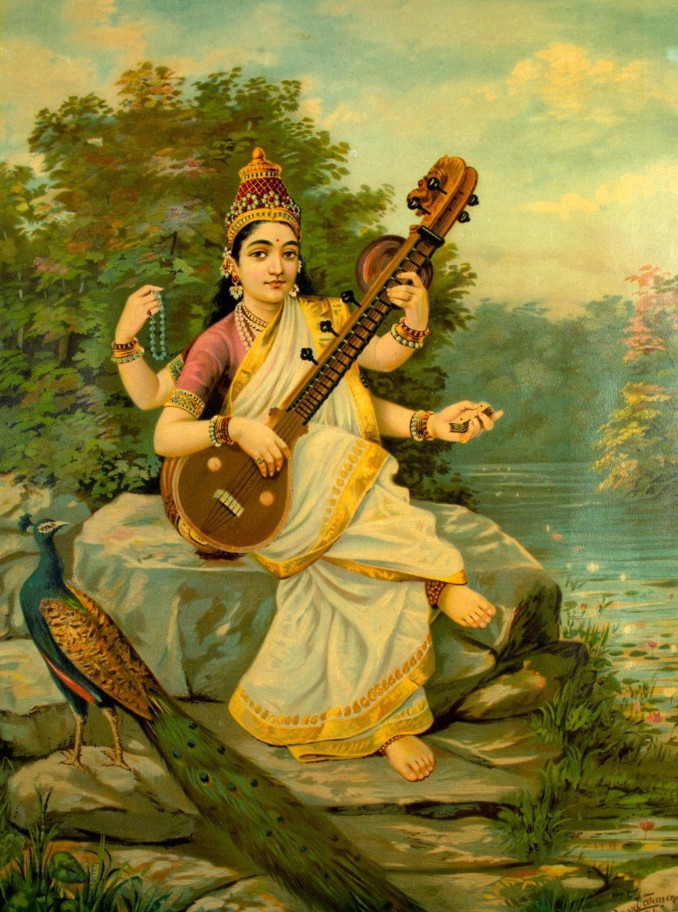
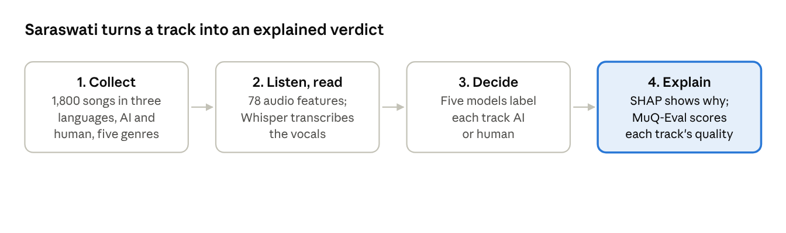

## The day I couldn't tell

I have been making music since 2012, mostly psytrance and trance, as a producer
and sometimes as a vocalist. My track "Krishna", with Omiki and Planet 6,
reached number one on Beatport. "Fortune & Glory", my collaboration with Dimibo,
came out on Armada Music in its "Who's Afraid of 138?!" series, and Armin van
Buuren played it on A State of Trance. A big part of my job has always been
quality control: sitting with a mix and listening for whatever stops it sounding
finished.

So, I assumed I would always be able to hear AI. Then Suno v5 came out in 2025.
From one text prompt it gives you a complete song, vocals and all, in English,
Hindi, Mandarin and many other languages. I played its tracks next to human
releases, and honestly, I could not always tell which was which.

## A song used to take a whole team

Making a song has always been a team effort. A musician plays the parts, and a
lyricist writes the words. A producer arranges everything in a DAW (digital
audio workstation), a vocalist records the vocals, and then the stems go through
gain staging, mixing and finally mastering. Everyone in that chain matters, and
you can hear their work in the final track.

That is starting to fade. Today, someone who has never made music can generate a
song, upload it and get paid for a lot of streams. Real artists are feeling it.
There is a quieter cost too: when a young producer releases a great track now,
older artists start to wonder whether they really made it with their own samples
and their own effort, or whether a model did the work.

It reminds me of the early days of the internet. The change was already
happening, and most of us were not ready to accept it.

## So, I built Saraswati!

For my MSc dissertation at the University of Hull, I wanted to find out what
really separates an AI song from a human one, in a way I could measure and
explain.

The result is Saraswati. I named it after the Hindu goddess of knowledge and
music, who holds a veena in one hand and a manuscript in the other. The system
follows the same idea: it listens to the sound of each song and reads its
lyrics. I put together 1,800 full songs, with 300 AI and 300 human tracks in
each of English, Hindi and Mandarin, spread across five genres: Pop, Rock,
Hip-Hop/Rap, R&B/Soul and Folk/Acoustic. Every AI track came from Suno v5.

Saraswati, goddess of knowledge and music, by Raja Ravi Varma (c. 1896). Public domain.

Saraswati works in four steps:

1. **Collect.** It starts with the 1,800 songs: AI and human, in three languages
   and five genres.
2. **Listen and read.** It measures 78 audio features from every track. At the
   same time, Demucs pulls the vocals out of the mix and Whisper writes down the
   lyrics, which become 15 hand-built lyric features and a multilingual sentence
   embedding.
3. **Decide.** Five machine learning models label each track as AI or human.
4. **Explain.** SHAP shows which features drove each decision, and MuQ-Eval
   gives every single track its own quality score, instead of one number for a
   whole dataset.

The four steps of the Saraswati pipeline.

## The biggest surprise: AI sounded better

Going in, I expected to catch AI by its mistakes. I was wrong. When MuQ-Eval
scored all 1,800 songs, the AI tracks came out higher on average than the human
recordings, 4.600 against 4.251. Pick one AI track and one human track at
random, and the AI one scores higher 74.6% of the time. That held in all three
languages.

So, if you are hunting for bad audio, you are looking in the wrong place. What
gives AI away is something you mostly cannot hear. The strongest clue is
spectral flux, which measures how much the sound changes from one moment to the
next, and AI tracks change less. Their texture is more uniform, their timbre is
flatter and their frequency spread is narrower. They also get brighter and
louder across a song more steeply than human tracks do.

Using features like these, Saraswati told AI and human songs apart with a
Macro-F1 score of 0.975 when audio and lyrics were combined. Macro-F1 measures
how accurately both AI and human songs are labelled, where 1.0 would mean every
song was right. On a stricter test, where no artist or near-duplicate lyrics
appeared in both training and testing, audio alone reached a Macro-F1 of 0.986.

## The traps I nearly fell into

This is the part I learned the most from. My AI songs came straight from Suno,
while the human songs came from YouTube, and that alone makes them different.
60.3% of the human tracks were clipped, against only 6.1% of the AI tracks, and
the human tracks were about 2.4 LUFS louder on average. A model could easily
learn "loud and clipped means human" and look brilliant without learning
anything about music.

So, I removed 16 features linked to how the files were collected. Even then, a
simple model that looked only at the file format (codec, bitrate, sample rate
and channels) scored 0.995. That was a real shock. To make sure Saraswati was
hearing the music and not the file, I re-encoded 365 tracks through the same
loudness and codec chain, and the audio model still scored 0.972.

Languages had their own trap. Mandarin has no spaces between words, so my first
lyric code quietly broke on it. It ran without a single error and gave results
that looked significant but meant nothing. Proper word segmentation fixed it. If
you build multilingual tools, that is my biggest lesson: check that every
language works, not just that the code runs.

## Adapt, but label it

Saraswati is my contribution to fixing this. Instead of a gut feeling, it gives
evidence: which features gave a track away, and how strongly. But as the models
keep improving, detection alone will not be enough. We also need watermarking,
so AI music is labelled at the source and listeners, platforms and artists know
what they are hearing.

At the same time, we as musicians need to accept this change. AI is already
making our process faster. Instead of spending hours digging through Splice and
other sample sites, we can sketch a song idea in minutes and spend our time
making it more interesting. What I want is honesty about where AI is used, so
that human craft still gets recognised and paid.

## What's next

Saraswati has limits, and I want to be upfront about them. It has only been
tested on Suno v5, and other generators such as Udio or MusicGen may leave
different fingerprints. The quality scores also come from one automatic model,
so they still need checking against real listeners.

I am now applying for PhD positions in AI for sound, to take this further into
detecting, tracing and watermarking AI-generated audio. I would also love to
work with industry. If your company works with music, audio or AI and cares
about where its tracks come from, please get in touch at
[nktshrd@gmail.com](mailto:nktshrd@gmail.com).

Thank you to my supervisor, Eva Sousa of the University of Hull, and my
co-supervisor, Dr Xiangming Zhang of the Norwegian University of Science and
Technology (NTNU), for guiding me through this project, and to the DAIM centre
for the chance to share it.

---

*Ankit Sharda completed an MSc in Artificial Intelligence and Data Science at
the University of Hull in 2026. He has produced psytrance and trance since 2012,
with releases on Armada Music, Spin Twist Records and Eclipse Records. His work
has reached number one on Beatport and been played by Armin van Buuren on A
State of Trance.*
